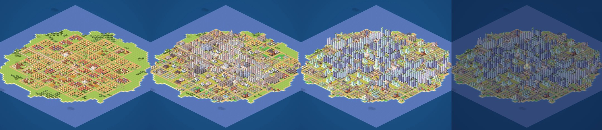
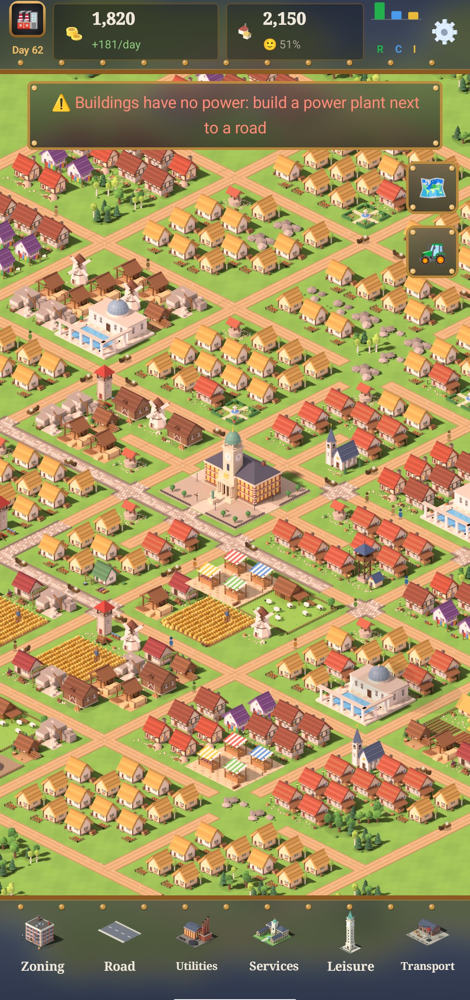
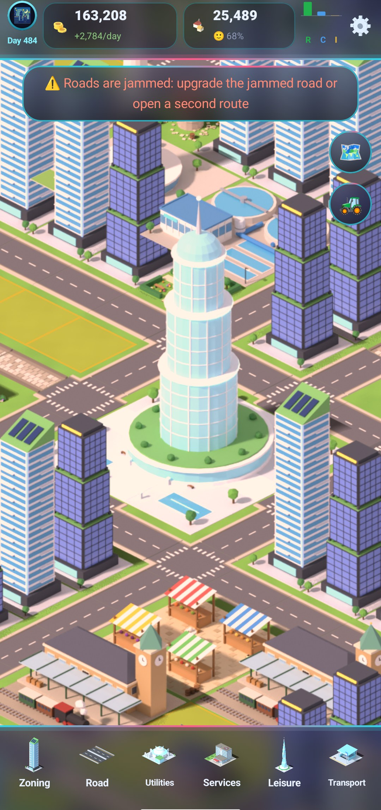
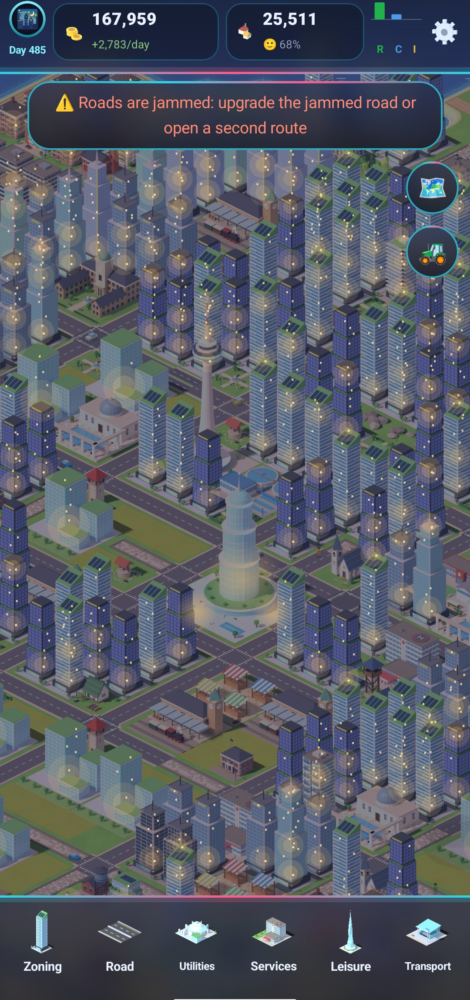

# PocketVille

**Grow a village into a metropolis.** Lay the roads, paint residential, commercial and industrial zones, and settlers build their own homes, shops and factories. Keep the water running, the lights on and the traffic moving, and a little island with a market square grows into a skyline. No ads, no rush.

  
  &nbsp;
  
  &nbsp;
  

## Download

🏙️ **[Website: serkantkn.github.io/PocketVille](https://serkantkn.github.io/PocketVille/)**

The latest version is on the [**Releases**](https://github.com/serkantkn/PocketVille/releases) page.

| Device | File | Needs |
|---|---|---|
| Android phone and tablet | `PocketVille-<version>.apk` | Android 9 or later |
| Mac | `PocketVille-<version>-mac.dmg` | Apple silicon Mac (M1 and later) |

The iPhone and iPad version is ready but can't be distributed here until it goes through the App Store / TestFlight.

## What's in the game

- **You plan, they build.** Draw roads, paint zones next to them, and if there's demand, settlers move in and put up their own buildings. Three demand bars tell you what the city wants.
- **Four eras.** Village, industrial, modern and metropolis. Each unlocks new zones, roads and buildings; old quarters stand next to the new ones until they rebuild themselves.
- **Utilities and services.** Water and power flow along the roads. Police, fire, health, schools, parks and waste each cover an area and have their own budget. Info layers show water, power, pollution, land value, crime, coverage and traffic.
- **Real traffic.** Trips are routed over your road network and roads jam when they fill up. Streets, avenues, boulevards, highways, one-way and tree-lined roads; trams, buses and the metro.
- **A city with a life of its own.** Lights at night, cars and people in the streets, fires, festivals, tourists, trade missions, advisors and a news ticker.
- **It keeps going while you're away**, for up to 12 hours.
- **Cloud save** with Google on Android, or Apple and Google on iPhone. Optional; everything works without an account. The Mac version keeps its city on the Mac for now.
- **Six languages:** English, Turkish, French, German, Spanish and Italian.

All 140+ building designs and road pieces are modelled in Blender and rendered under the same light.

## Privacy

No ads, analytics or tracking. If you don't sign in, your city stays on your device. If you sign in, your city save and the name of the device that saved it are stored in Google Firebase under your account; you can delete both from Settings at any time. At launch the game asks the internet for the time, so moving the clock forward doesn't pay off. Details: [privacy policy](https://serkantkn.github.io/PocketVille/privacy.html).

## Bugs and ideas

If something goes wrong or you have an idea, please [open an issue](https://github.com/serkantkn/PocketVille/issues). Mentioning your device and the game version helps a lot.

This repository holds the releases and feedback; the game's source code is kept separately.

---

## Türkçe

**Köyünü metropole büyüt.** Yolları döşe, konut, ticaret ve sanayi bölgelerini çiz; yerleşimciler evlerini, dükkânlarını ve fabrikalarını kendileri kursun. Suyu akıt, elektriği ulaştır, trafiği yürüt; pazar meydanlı küçük bir ada gökdelenlerle dolu bir şehre dönüşsün. Reklam yok, acele yok.

- **Sen planlarsın, halk kurar.** Yol çiz, kenarına imar bölgesi boya; talep varsa yerleşimciler gelip binalarını kurar.
- **Dört çağ:** köy, sanayi, modern ve metropol. Eski mahalleler kendilerini yenileyene kadar yenilerin yanında durur.
- **Şebekeler ve hizmetler:** su, elektrik, polis, itfaiye, sağlık, eğitim, park ve çöp; her birinin kapsama alanı ve bütçesi var. Bilgi katmanları sorunun nerede olduğunu gösterir.
- **Gerçek trafik:** yolculuklar yol ağında gerçek bir yoldan gider, dolan yol tıkanır. Cadde, bulvar, otoyol, tek yönlü ve ağaçlı yollar; tramvay, otobüs ve metro.
- **Yaşayan şehir:** gece ışıkları, yangınlar, şenlikler, turistler, danışmanlar ve haber bandı. Sen yokken de 12 saate kadar yaşar.
- **Bulut kaydı:** Android'de Google, iPhone'da Apple ya da Google ile; isteğe bağlı. Mac sürümü şehrini şimdilik Mac'te tutar.
- **Altı dil:** Türkçe, English, Français, Deutsch, Español, Italiano.

Site: [serkantkn.github.io/PocketVille](https://serkantkn.github.io/PocketVille/). İndirmek için [Releases](https://github.com/serkantkn/PocketVille/releases): Android 9 ve üstü için APK, Apple çipli Mac için DMG. Reklam, analiz ve izleme yok; giriş yaparsan şehir kaydın ve cihazının adı hesabına bağlı olarak Google Firebase'de saklanır, ikisini de Ayarlar'dan silebilirsin. Sorunları [buradan bildir](https://github.com/serkantkn/PocketVille/issues).
